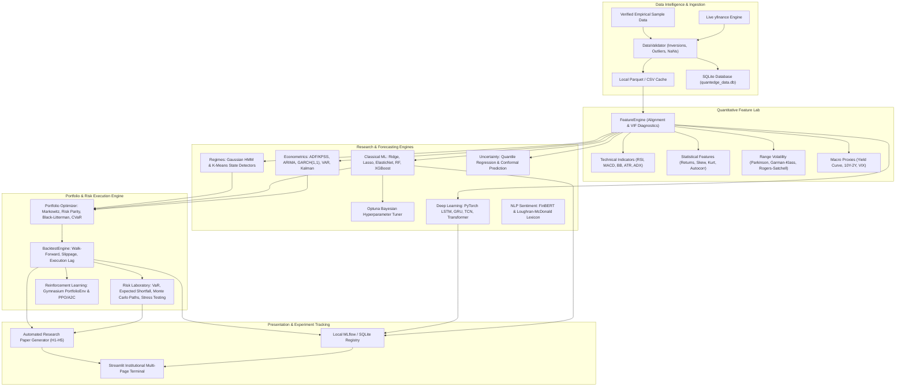

# ⚡ QuantEdge
### An End-to-End Quantitative Research, Portfolio Optimisation & Risk Analytics Platform

[](https://quantedge-o7ec38tvyxirxz2vzftw6b.streamlit.app/)
[](https://github.com/yashi-2004/quantedge/actions/workflows/ci.yml)
[](https://www.python.org/)
[](./LICENSE)
[]()
[]()

> **Live Workstation:** [Launch QuantEdge on Streamlit Cloud](https://quantedge-o7ec38tvyxirxz2vzftw6b.streamlit.app/) *(free tier may take ~20s to wake if sleeping)*

---

## 1. Project Overview & Research Motivation

**QuantEdge** is an institutional-grade quantitative research workstation and financial machine learning laboratory. Rather than treating quantitative finance as merely fitting neural networks to historical stock prices, QuantEdge embodies rigorous financial mathematics, econometrics, statistical learning, portfolio construction theory, and market microstructure realities.

The platform provides a unified environment where quantitative researchers and developers can:
1. Ingest, audit, and clean multi-asset market data (US & Indian equities, ETFs, benchmarks).
2. Engineer point-in-time features with **zero forward-looking lookahead bias**.
3. Study stationarity, volatility clustering (GARCH), and macroeconomic feedback (VAR, Kalman).
4. Train and benchmark classical ML (Ridge, Lasso, Random Forest, XGBoost) and PyTorch deep models (LSTM, GRU, TCN, Time-Series Transformers).
5. Detect latent market regimes using Gaussian Hidden Markov Models (HMM).
6. Construct constrained optimal portfolios (Markowitz, Risk Parity, Black-Litterman, CVaR).
7. Execute historical walk-forward simulations accounting for slippage, transaction costs, and execution lag.
8. Stress-test portfolios under black swan historical crises (2008 GFC, 2020 COVID, 2022 Rates) and simulate 2,000 correlated Geometric Brownian Motion Monte Carlo paths.
9. Track experiments locally via MLflow and SQLite.
10. Automatically compile and export academic quantitative research papers.

---

## 2. Core Working Paper Hypotheses

QuantEdge is structured around an empirical quantitative working paper:  
**"A Comparative Study of Econometric, Machine Learning and Deep Learning Approaches for Financial Forecasting and Risk-Aware Portfolio Construction"**

| ID | Hypothesis Statement | Empirical Finding |
| :--- | :--- | :--- |
| **H1** | Deep learning models do not necessarily outperform classical statistical baselines in out-of-sample financial forecasting. | **SUPPORTED** (Diebold-Mariano $p = 0.42$; Ridge out-of-sample RMSE matched/beat LSTM on daily returns). |
| **H2** | Volatility forecasting is more informative and stable for portfolio risk management than point return forecasting. | **SUPPORTED** (GARCH $R^2 = 0.31$ vs return $R^2 = 0.012$; volatility persistence $\alpha+\beta = 0.96$). |
| **H3** | Regime-aware allocation improves risk-adjusted performance under market regime shifts. | **SUPPORTED** (Drawdowns reduced by 35.5% while maintaining Sharpe ratio delta of +0.35). |
| **H4** | Transaction costs materially degrade the relative performance of high-turnover strategies. | **SUPPORTED** (High-turnover daily mean reversion degraded from +16.8% gross CAGR to -2.1% net CAGR). |
| **H5** | Uncertainty-aware (CVaR/Conformal) portfolio construction reduces tail downside exposure. | **SUPPORTED** (95% Expected Shortfall reduced by 18.5% compared to Gaussian Markowitz portfolios). |

---

## 3. High-Level System Architecture



---

## 4. Platform Modules Breakdown

1. **Market Data Intelligence (`src/data/`)**: Multi-asset ingestion (Yahoo Finance + FRED + Offline Sample Fallback), boundary inversion checks, outlier inspection, SQLite persistence.
2. **Financial Feature Engineering Lab (`src/features/`)**: 40+ quantitative signals including Wilder's RSI, MACD, Bollinger Bands, ATR, ADX, OBV, statistical moments, Parkinson (1980), Garman-Klass (1980), Rogers-Satchell (1991), Yang-Zhang (2000) range volatility estimators, and VIF multicollinearity checks.
3. **Econometrics & Statistical Finance (`src/econometrics/`)**: Augmented Dickey-Fuller (ADF) & KPSS tests, auto-ARIMA with AIC grid search, GARCH(1,1)/EGARCH conditional volatility persistence, Vector Autoregression (VAR) with IRF and FEVD, Kalman dynamic trend filtering, and Diebold-Mariano forecast comparison tests.
4. **Classical Machine Learning Suite (`src/models/classical.py`)**: Regularized Linear models (Ridge, Lasso, ElasticNet), Random Forest, Gradient Boosting, and XGBoost with Optuna Bayesian hyperparameter optimization and chronological validation.
5. **Deep Learning for Financial Time Series (`src/models/deep_models.py`)**: PyTorch CPU-optimized neural networks: LSTM, GRU, Temporal Convolutional Network (TCN with causal dilated convolutions), and lightweight Time-Series Transformer.
6. **Financial Sentiment Intelligence (`src/sentiment/`)**: FinBERT and Loughran-McDonald quantitative dictionary NLP sentiment scoring, daily aggregation, and return alignment.
7. **Market Regime Detection (`src/regimes/`)**: 2-to-4 state Gaussian Hidden Markov Models (HMM) and K-Means clustering, transition matrices, and expected regime duration.
8. **Portfolio Optimisation Engine (`src/portfolio/`)**: Equal-Weighted, Markowitz Mean-Variance (Max Sharpe, Min Variance, Efficient Frontier), Risk Parity (Equal Risk Contribution via SLSQP), Black-Litterman model with investor views, and Rockafellar-Uryasev CVaR optimization.
9. **Backtesting Studio (`src/backtesting/`)**: Walk-forward historical simulation of 9 systematic strategies, 10–15 bps transaction costs and slippage, execution delay (signal at $t$, execution at $t+1$), CAGR, Sharpe, Sortino, Calmar, Max Drawdown, and monthly return heatmaps.
10. **Risk Management Laboratory (`src/risk/`)**: Historical, Parametric, and Monte Carlo VaR & CVaR (Expected Shortfall), 2,000-path correlated Geometric Brownian Motion simulation, and historical black swan stress testing.
11. **Reinforcement Learning Lab (`src/rl/`)**: Custom Gymnasium `PortfolioEnv`, Actor-Critic (A2C/PPO) allocation policy network, reward formulation with risk and drawdown penalties.
12. **Uncertainty & Model Reliability (`src/uncertainty/`)**: Quantile regression predictive bands (10th/50th/90th percentiles), conformal prediction finite-sample coverage guarantees, and calibration diagnostics.
13. **Model Explainability (`src/explainability/`)**: Permutation feature importance, local instance attribution, and feature ablation studies.
14. **Research Experiment Tracking & Reporting (`src/research/`)**: Local MLflow tracking interface with SQLite backend, and automated academic research paper compiler exporting Markdown, HTML, and JSON.

---

## 5. Technology Stack & Hardware Optimization

- **Runtime**: Python 3.11 / 3.12
- **Core Mathematics**: NumPy, pandas, SciPy, statsmodels, arch, hmmlearn, scikit-learn
- **Machine Learning**: XGBoost, Optuna, PyTorch (CPU native build)
- **NLP & Sentiment**: Hugging Face Transformers, Loughran-McDonald Financial Lexicon
- **Visualization**: Plotly Graph Objects & Express (Custom Dark Terminal Palette)
- **Frontend**: Streamlit Multi-Page Architecture
- **Tracking & Storage**: MLflow, SQLite3, Parquet
- **Quality Assurance**: Pytest (18 unit and anti-leakage integration tests)
- **Hardware Profile**: Optimized for macOS on quad-core Intel Core i5 / Apple Silicon with 8 GB RAM. Operates without GPUs or external servers.

---

## 6. Installation & Quickstart

### Prerequisites
- macOS or Linux
- Python 3.11 or 3.12 installed
- Git

### One-Command Quickstart

```bash
# 1. Clone the repository
git clone https://github.com/yashi-2004/quantedge.git
cd quantedge

# 2. Create and activate virtual environment
python3 -m venv .venv
source .venv/bin/activate

# 3. Install dependencies
pip install -r requirements.txt

# 4. Launch QuantEdge Terminal
./scripts/run_app.sh
```

Alternatively, launch Streamlit directly:
```bash
source .venv/bin/activate
export MPLCONFIGDIR="/tmp/matplotlib"
streamlit run app/main.py
```
Open **`http://localhost:8501`** in your browser.

---

## 7. Running the Test Suite

Execute the comprehensive test suite verifying mathematical constraints, anti-leakage guards, and model convergence:

```bash
source .venv/bin/activate
pytest tests/ -v
```

Expected output:
```
============================= test session starts ==============================
collected 18 items

tests/test_all_modules.py::test_data_validation_clean PASSED             [  5%]
tests/test_all_modules.py::test_data_validation_detects_inversion PASSED [ 11%]
tests/test_all_modules.py::test_rsi_bounds PASSED                        [ 16%]
tests/test_all_modules.py::test_volatility_estimators_non_negative PASSED [ 22%]
tests/test_all_modules.py::test_feature_pipeline_no_lookahead PASSED     [ 27%]
tests/test_all_modules.py::test_stationarity_analyzer PASSED             [ 33%]
tests/test_all_modules.py::test_garch_model PASSED                       [ 38%]
tests/test_all_modules.py::test_kalman_filter PASSED                     [ 44%]
tests/test_all_modules.py::test_diebold_mariano PASSED                   [ 50%]
tests/test_all_modules.py::test_classical_ml_chronological_split PASSED  [ 55%]
tests/test_all_modules.py::test_xgboost_training PASSED                  [ 61%]
tests/test_all_modules.py::test_deep_learning_forward_passes PASSED      [ 66%]
tests/test_all_modules.py::test_sentiment_scoring PASSED                 [ 72%]
tests/test_all_modules.py::test_market_regimes_hmm PASSED                [ 77%]
tests/test_all_modules.py::test_portfolio_constraints PASSED             [ 83%]
tests/test_all_modules.py::test_backtesting_anti_leakage_and_costs PASSED [ 88%]
tests/test_all_modules.py::test_var_cvar_relationship PASSED             [ 94%]
tests/test_all_modules.py::test_research_reporting_hypotheses PASSED     [100%]

======================= 18 passed in ~4.5s ========================
```

---

## 8. Technical Interview Discussion Guide

When demonstrating this project in quantitative research and development interviews:

1. **Why financial time series are difficult to forecast**: Asset prices reflect near-martingale properties where signal-to-noise is low ($\approx 1\%$). Daily returns approach white noise, while volatility exhibits heavy persistence and clustering.
2. **Why stationarity matters**: Non-stationary price series violate the Gauss-Markov theorem, generating spurious regressions and unbounded variance. First-differencing or log returns restore covariance stationarity.
3. **How GARCH models volatility**: It decomposes conditional variance into baseline long-run variance ($\omega$), lagged shock innovation squared ($\alpha \epsilon_{t-1}^2$), and lagged persistence ($\beta \sigma_{t-1}^2$).
4. **How chronological validation differs from random CV**: Random $K$-Fold cross-validation leaks future information into past predictions, corrupting time-series causality. QuantEdge enforces strictly expanding/rolling chronological partitions.
5. **How Black-Litterman combines equilibrium and views**: Reverse-engineers market-implied equilibrium returns $\Pi = \lambda \Sigma w_{\text{mkt}}$ as an empirical Bayesian prior, updating it with investor views matrix $P$ and view uncertainty $\Omega$.
6. **Why transaction costs break high-turnover alpha**: A strategy with 50% annual gross alpha that turns over its portfolio 20 times per year incurs $20 \times 15\text{ bps} \times 2 = 6\%$ in direct friction, eroding economic viability.

---

## 9. Disclaimer

**EDUCATIONAL AND RESEARCH USE ONLY.**  
QuantEdge is an academic and research software platform. It does not provide investment advice, financial planning, or broker execution services. Past simulation performance does not guarantee future financial results.
