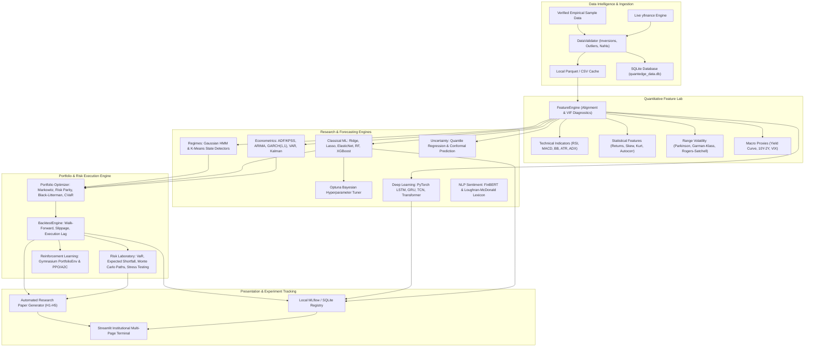

# QuantEdge System Architecture

## 1. Architectural Philosophy

QuantEdge is engineered as a modular, research-grade quantitative workstation designed around four fundamental principles:

1. **Zero-Cost Local Autonomy**: Complete functionality without cloud dependencies, paid API keys, or SaaS subscriptions.
2. **Strict Epistemic Causality**: Zero look-ahead bias through explicit temporal alignment, signal-to-execution lags, and expanding/rolling chronological validation.
3. **Mathematical Rigor**: Unambiguous separation between predictive statistical fit, in-sample calibration, out-of-sample forecast accuracy, and economically net-profitable trading performance.
4. **Hardware-Conscious CPU Optimization**: Memory-efficient sliding window generators, vectorization via NumPy/SciPy/pandas, cached font lists, and lightweight deep architectures operable on 8 GB RAM quad-core hardware.

---

## 2. High-Level System Architecture Diagram



---

## 3. Core Directory Organization

```
quantedge/
├── app/
│   ├── main.py                     # Workstation entrypoint & dashboard overview
│   ├── components/
│   │   └── ui.py                   # Terminal dark theme styling & Plotly templates
│   └── pages/
│       ├── 01_market_overview.py   # Price action, distributions, and drawdowns
│       ├── 02_data_explorer.py     # Ingestion, validation reports, and CSV upload
│       ├── 03_feature_lab.py       # Technical, statistical, and volatility features
│       ├── 04_econometric_models.py# ADF/KPSS, ARIMA, GARCH, VAR, Kalman filter
│       ├── 05_ml_forecasting.py    # Classical ML, Optuna tuning, and baselines
│       ├── 06_deep_learning.py     # PyTorch LSTM, GRU, TCN, and Transformer
│       ├── 07_sentiment_analysis.py# FinBERT & Loughran-McDonald NLP sentiment
│       ├── 08_market_regimes.py    # Gaussian HMM & K-Means clustering
│       ├── 09_portfolio_optimisation.py # Markowitz, Risk Parity, Black-Litterman, CVaR
│       ├── 10_backtesting.py       # Walk-forward historical backtesting studio
│       ├── 11_risk_analytics.py    # VaR, CVaR, Monte Carlo paths, and stress tests
│       ├── 12_reinforcement_learning.py # Gymnasium PortfolioEnv & Actor-Critic
│       ├── 13_experiment_tracking.py # Local MLflow tracking interface
│       └── 14_research_reports.py  # Automated research paper generator (H1–H5)
│
├── src/
│   ├── data/                       # Ingestion, validation, caching, and storage
│   ├── features/                   # Technical, statistical, volatility, and macro features
│   ├── econometrics/               # Time series models and hypothesis tests
│   ├── models/                     # Classical ML, tuning, and PyTorch deep models
│   ├── sentiment/                  # Financial NLP sentiment engine
│   ├── regimes/                    # Latent regime detection
│   ├── portfolio/                  # Convex and Bayesian portfolio allocation
│   ├── backtesting/                # Simulation engine and strategy library
│   ├── risk/                       # VaR, CVaR, Monte Carlo, and stress tests
│   ├── rl/                         # Gymnasium environment and Actor-Critic agent
│   ├── uncertainty/                # Quantile regression and conformal prediction
│   ├── explainability/             # Global/local attributions and feature ablation
│   └── research/                   # Experiment tracking and research reports
│
├── datasets/                       # Local offline sample datasets and caches
├── experiments/                    # Local SQLite MLflow tracking database
├── reports/                        # Exported research reports
├── tests/                          # Comprehensive Pytest automated test suite
├── docs/                           # Architectural, mathematical, and research documentation
└── scripts/                        # Startup and automation scripts
```
